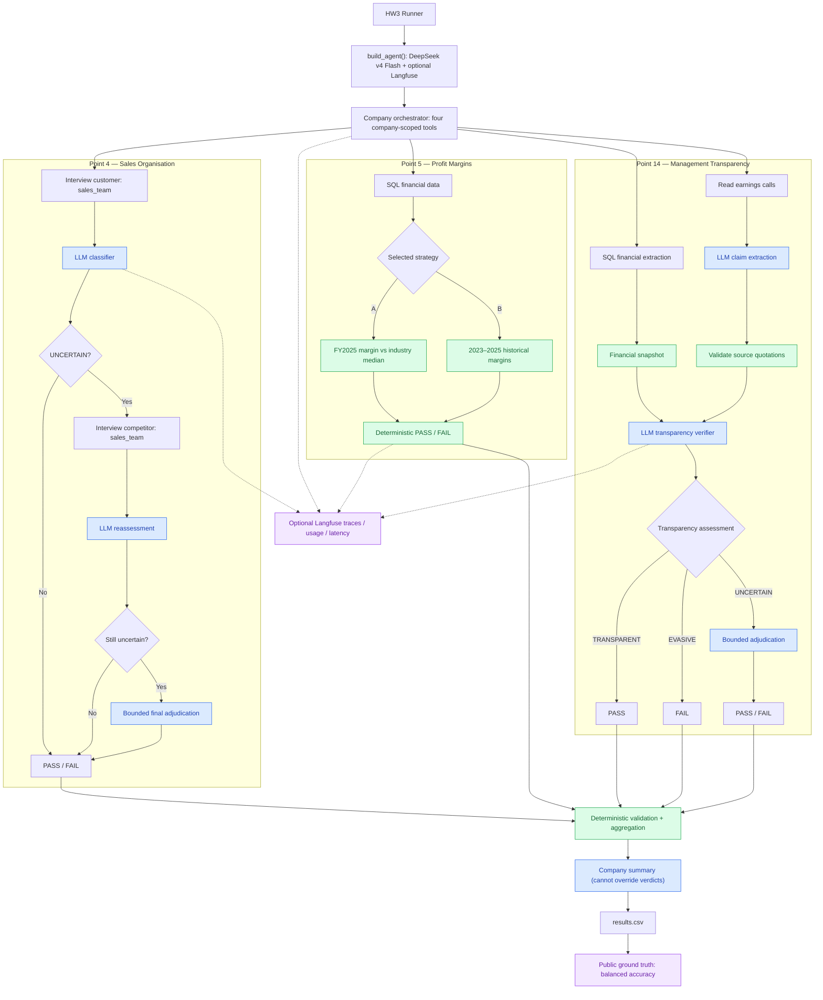

# FTEC5660 Homework 3: Fisher's 15-Point Investment Agent

Build a LangChain agent that researches a company with tools and applies the
framework from Philip Fisher's *Common Stocks and Uncommon Profits* (Part One,
Chapter 3 "What to buy: the fifteen points to look for in a common stock", and
Chapter 4 "What to buy: applying this to your own needs"). You choose 3 of
Fisher's 15 points and decide yourself what PASS means for each. For every
company your agent gives a PASS/FAIL verdict on your 3 points and a short
summary.

The companies are fictional, so the model cannot answer from memory. Unlike a
pile of reports, the evidence is spread over three sources, and your agent has
to go and get it with tools, the way Fisher's "scuttlebutt" method sends an
investor to talk to customers, competitors, suppliers and staff.

## Data and tools

`public_test/` has one folder per company. Your code receives four tools per
company (built by the provided code in `hw3.py`):

| Tool | What it gives you |
| --- | --- |
| `list_documents()` | the company's six documents and their dates |
| `read_document(name)` | one document: the 2025 letter to shareholders, four earnings calls (Q3 2025 to Q2 2026) and a news file (July 2025 to July 2026) |
| `sql_query(query)` | one read-only SQLite query on the company's database; at most 50 rows come back, so use `SUM`, `GROUP BY` and `WHERE` |
| `interview(role, topic)` | what one person says about the company; at most **10 interviews per company** |

The documents are what management says. Management's own claims (such as "we
have never cut research" or "our people are our greatest strength") are not
evidence on their own: check them against the database and the interviews.

**Database tables** (amounts in USD thousands; dates `YYYY-MM-DD`, months
`YYYY-MM`, quarters like `2025Q3`; the fiscal year is the calendar year):

| Table | Columns |
| --- | --- |
| `company` | name, industry |
| `industry_medians` | industry, revenue_growth_2y_pct, new_product_share_pct, new_product_sales_per_rd, operating_margin_pct (one row per industry; use the row for the company's own industry) |
| `orders` | order_id, order_date, product, customer, amount, note (about 3,000 to 4,000 orders from January 2023 to June 2026; revenue is the sum of order amounts) |
| `products` | product, launch_date |
| `monthly_costs` | month, cost_of_sales, selling_admin, research_development |
| `quarterly_cash` | quarter, operating_cash_flow, capex, cash_end |
| `capex_plan` | year, planned_capex (2026 to 2028) |
| `returns` | month, units_shipped, units_returned |
| `insider_trades` | trade_date, person, title, side (`buy` or `sell`), shares, price |

**Terms used in the data.**

| Term | Meaning |
| --- | --- |
| FY2025 | Fiscal year 2025. Here the fiscal year is the calendar year, so FY2025 is January to December 2025. |
| Quarter | Three months of the year: Q1 is January to March, Q2 April to June, Q3 July to September and Q4 October to December. The database writes `2025Q3`; the documents write "third quarter 2025". |
| Amounts | The database is in **USD thousands** (676,100 means US$676.1 million). The documents use USD millions. |
| Revenue | Money from sales: the sum of `amount` in `orders`. |
| Cost of sales | The cost of making the products that were sold. |
| Selling and admin | The cost of selling and of running the company (sales staff, offices, management). |
| R&D | Research and development spending, mainly on new products. |
| Operating margin | Operating profit as a share of revenue: (revenue − cost of sales − selling and admin − R&D) ÷ revenue. |
| Operating cash flow | Cash that the day-to-day business brings in during a quarter. |
| Cash at the end of a quarter | The cash the company holds on the last day of that quarter (`cash_end`). |
| Capex | Capital expenditure: spending on factories, machines and other long-term assets. `capex_plan` holds the planned capex for 2026 to 2028. |
| Return rate | Units returned ÷ units shipped, from the `returns` table. |
| Industry median | The middle value for companies in the same industry, from `industry_medians`. |
| Insider | A director or senior manager of the company. `insider_trades` lists the shares they bought (`buy`) or sold (`sell`). |
| Earnings call | A meeting each quarter where management presents the quarter's results to investors. Each call quotes that quarter's revenue. |

**Interviews.** Roles: `customer`, `current_employee`, `former_employee`,
`competitor`, `supplier`. Topics: `sales_team`, `working_conditions`,
`top_management`, `decision_making`, `competitive_edge`. Only some people know
about each topic; the others say they can't comment, and that answer still
uses up one interview.

| Topic | Who knows about it |
| --- | --- |
| `sales_team` | customer, competitor |
| `working_conditions` | current_employee, former_employee |
| `top_management` | former_employee, supplier |
| `decision_making` | supplier, customer |
| `competitive_edge` | competitor, customer |

People who know about a topic always agree with each other, so one good answer
is enough.

## Choose your 3 points and your rules

Pick any 3 of Fisher's 15 points and write them in `CHOSEN_POINTS` near the
top of `hw3.py`, e.g. `CHOSEN_POINTS = [1, 7, 15]`. The full questions are in
`FISHER_POINTS` in `hw3.py` and in the book.

| # | Fisher's point | Where the evidence is |
| --- | --- | --- |
| 1 | Market potential for sales growth | database |
| 2 | New products as current lines mature | database |
| 3 | Effective research and development | database |
| 4 | Above-average sales organization | interviews (`sales_team`) |
| 5 | Worthwhile profit margin | database |
| 6 | Maintaining or improving margins | database |
| 7 | Labour and personnel relations | interviews (`working_conditions`) |
| 8 | Executive relations | interviews (`top_management`) |
| 9 | Depth of management | interviews (`decision_making`) |
| 10 | Cost analysis and accounting controls | earnings calls, checked against the database |
| 11 | Advantage over competitors | interviews (`competitive_edge`) |
| 12 | Long-range outlook on profits | database |
| 13 | Growth without dilutive equity financing | database |
| 14 | Management talks freely about troubles | earnings calls, checked against the database |
| 15 | Management of unquestionable integrity | news file, checked against the database |

For each of your points, **you design the rule**: which evidence to use, what
to compute or whom to ask, and where the line between PASS and FAIL lies. PASS
means the company looks favourable on that point, as Fisher would see it.

We grade your verdicts against our own answer key. It uses one fixed rule per
point, which we do not publish, and the data never puts a company close to
the line of that rule, so a sensible reading of Fisher usually gives the same
answer. **Test your rules on the public answers**:
`public_test/ground_truth.json` gives the expected verdict on all 15 points
for each of the 20 public companies, and every point fails in 6 of them. If
your rule disagrees with the public answers, rethink it.

**Tip: calculate with tools, not in your head.** Do every sum, ratio and
comparison in SQL or Python, including the number of days between two dates
(SQLite's `julianday()` gives a date as a number of days).

## Student task

Fill in the three places in `hw3.py` marked `### YOUR CODE HERE`. You may add
imports, constants and helper functions above them, but do not change the
provided code below them:

- `CHOSEN_POINTS` lists your 3 points.
- `build_agent()` creates your model and anything else you need once.
- `analyze_companies(agent, companies)` receives
  `{company_folder: [list_documents, read_document, sql_query, interview]}`
  and returns, for every company,
  `{"points": {1: "PASS", 7: "FAIL", 15: "PASS"}, "summary": "..."}` (here with
  `CHOSEN_POINTS = [1, 7, 15]`).

Use the course techniques that fit your points: tool use for the database and
the interviews, planning which interviews to spend, routing each point to the
right source, prompt chaining, parallel calls, reflection to check your
answers, or a combination. Your code must read company data **only through
the four tools**; do not open `company.db` or `interviews.dat` yourself. Do
not hard-code folder names, company names or the public answers.

## Setup and public test

```bash
python3 -m venv .venv
source .venv/bin/activate
pip install -r requirements.txt
echo "DEEPSEEK_API_KEY=your_key_here" > .env
python3 hw3.py --data-folder public_test
```

Use your own DeepSeek API key (from https://platform.deepseek.com). The
required model is `deepseek-v4-flash`. We grade with our own key, so never put
a key in your code; `.env` must stay out of git.

The program creates `results.csv` with the columns `company`, `points`,
`points_correct`, `point_errors`, `interviews_used` and `summary`, and prints
the point score on your 3 points (the percentage after "balanced"). The point
score is the average of two shares: the share of truly passing verdicts that
you marked PASS and the share of truly failing verdicts that you marked FAIL.
For example, 90% and 60% give (90% + 60%) / 2 = 75%, and marking every point
PASS gives (100% + 0%) / 2 = 50%. Once `CHOSEN_POINTS` is set, the starter
runs before you add any API code (it returns no verdicts, so it scores 0%).

`public_test/ground_truth.json` gives the expected verdicts on all 15 points
for each public company. Grading uses a private set of about 20 unseen
companies with the same tools and the same answer key rules, but different
names and wording, and scores your 3 points only.

## Optional Langfuse tracing

Tracing is independent of the analysis implementation. `hw3.py`, its tools,
runner and grading functions are unchanged. The current starter makes no model
calls: the wrapper below records the run; future student components must pass
the reusable callback config to record their model/tool calls.

Normal homework execution needs only `DEEPSEEK_API_KEY`. Without Langfuse keys,
or if its optional SDK cannot initialize, tracing becomes a no-op. SDK callback
and export failures must not change company verdicts or stop the batch.

### Configuration

Use Python 3.11+ for the optional integration. Install the required homework
dependencies normally; add the optional SDK only when tracing is wanted:

```bash
pip install -r requirements-observability.txt
```

This pins Langfuse Python SDK **5.1.0**, using its native LangChain 1.x callback
integration. For self-hosting, SDK v5 requires Langfuse server v4.59.0 or later.
See the [SDK compatibility documentation](https://langfuse.com/docs/observability/sdk/overview).

Copy `.env.example` to `.env` if you do not already have one, then fill values
locally. Do not overwrite an existing `.env`. Set `DEEPSEEK_API_KEY`; optionally
add `LANGFUSE_PUBLIC_KEY`, `LANGFUSE_SECRET_KEY` and `LANGFUSE_BASE_URL` for your
Langfuse project. Use the matching regional URL, such as
`https://cloud.langfuse.com` (EU) or `https://us.cloud.langfuse.com` (US).
Keys are in your Langfuse project's Settings → API Keys. Do not paste or commit
them. `.env` and `.env.*` are ignored, except the blank `.env.example` template.

`LANGFUSE_TRACING_ENABLED=false` explicitly disables tracing even with keys.
`LANGFUSE_TRACING_ENVIRONMENT` labels the environment; `LANGFUSE_TIMEOUT`
sets the SDK request timeout in seconds (default 5). Configuration is read only
after environment loading; imports alone do not initialize the SDK.

### Runtime and component integration

Use this optional launcher once analysis has been implemented and points chosen:

```bash
python -m observability.run --data-folder public_test
```

It loads `.env`, owns one tracing lifecycle, calls the unchanged `hw3.main()`,
ends the root observation, then flushes and shuts down once. Exceptions and
exit status are preserved. SDK flush/shutdown errors are best effort; they are
not evidence of successful remote delivery. Wait for all company tasks and
observations to finish before closing. Do not create/close a separate SDK client
for each company: SDK resources are shared by project key.

Future student integration can inject `current_tracing()` into its components.
It returns the launcher's `Tracing` instance, or `None` under the original
`python hw3.py` launcher. The architecture task can wire this without changing
the observability module. For example, inside a component with an injected
`tracing` value and an existing LangChain model/chain:

```python
config = tracing.config(
    company_id=company_name, fisher_point=point_number,
    run_name="interpret-company-evidence",
) if tracing is not None else {}
response = await chain.ainvoke(payload, config=config)
```

The config includes company/point identifiers when supplied and the assignment
tag. Native callbacks capture the model name, inputs/outputs, latency, available
provider token usage and errors. Attach once at the outer LangChain invocation;
callbacks propagate to descendants. Reuse the company/point config without
attaching the same handler twice. Omit `fisher_point` for work spanning points.
Trace metadata uses string identifiers; point metadata is not a point selection.

Directly invoked supplied LangChain tools support the same config:
`tool.invoke(arguments, config=config)` or `await tool.ainvoke(arguments, config=config)`.
Their implementation and counters remain untouched. For a direct call that does
not support callbacks, use an explicit observation instead:

```python
with tracing.observation("retrieve-evidence", as_type="tool",
                         company_id=company_name, fisher_point=point_number,
                         input=arguments) as span:
    result = direct_call(arguments)
    span.update(output=result)
```

Use ordinary `with` inside async code too. Context follows async tasks. Do not
combine manual tool spans and native tool callbacks for the same call. Use an
outer company observation and nested point observations when grouping several
independent calls; these can contain native LangChain generations. Manual spans
record exception types and re-raise errors/cancellation. Native callbacks also
record error details, prompts and evidence: keep credentials and configuration
objects out of those payloads. The wrapper never sends environment variables.

### Tests and trace verification

```bash
python -m unittest discover -s test -v
```

Offline tests use mocks at the Langfuse/model boundary and real LangChain
execution to check callback events, usage forwarding, metadata isolation, direct
tools, errors and lifecycle behaviour. They require the normal homework
dependencies, not the optional SDK or credentials. The live test is skipped.

An optional smoke makes **one paid DeepSeek call**, runs a synthetic tool and
an intentional failing tool, then flushes. It performs no company analysis and
does not select points. After setting keys in `.env`, run:

```bash
LANGFUSE_LIVE_SMOKE=true python -m observability.smoke --live
```

Alternatively, run only the live unittest with the same opt-in:
`LANGFUSE_LIVE_SMOKE=true python -m unittest discover -s test -p test_tracing_smoke.py -v`.
Do not run both unless you want two paid calls. The test's opt-in must be in the
shell environment; keys may be in `.env`.

The smoke prints its trace ID. In your project's Tracing view, find that ID
(allow for asynchronous ingestion). Verify:

- Root name `hw3-observability-smoke`, assignment tag and `company_id=observability-smoke`.
- `fisher_point=1` is synthetic smoke metadata, not a homework choice.
- A child generation with `deepseek-v4-flash`, input/output, latency and nonzero token usage.
- The successful synthetic tool, the intentional tool error, and a distinct manually instrumented tool.
- One nested tree with correctly closed observations and no duplicate spans for the same tool call.

A printed ID or passing offline test does not prove ingestion. If nothing appears,
check region, keys, enabled flag and SDK logs; repeat the smoke only after fixing
configuration. Compare the trace with Langfuse's
[best practices](https://langfuse.com/docs/observability/best-practices) and
[LangChain integration](https://langfuse.com/integrations/frameworks/langchain).
This integration follows the [Langfuse AI skill](https://github.com/langfuse/skills/tree/main/skills/langfuse).

## Homework 3 solution:
> to students: this is your report, see the homework description.

### My 3 points and rules
> for each point: why you chose it, your PASS rule in one or two sentences, and the evidence it uses. Quote Fisher where it helps.

### Design

The following Mermaid diagram captures the **planned first integrated iteration**. Points 4, 5 and 14 are separate specialist workflows that may execute concurrently. Point 5's strategies are alternatives: the evaluation compares both, but the final runner uses only the selected one. The diagram does not claim that the concurrent specialist branches have already been integrated.



**Legend:** Blue marks LLM reasoning, green marks deterministic computation or validation, and purple marks observability or evaluation. The three specialists produce independent verdicts; a deterministic aggregator validates and combines them. Langfuse is optional and does not determine correctness, which is assessed separately against the public ground truth.

### Results
> your point score on `public_test`, the companies where your verdicts disagree with the public answers, and why.
