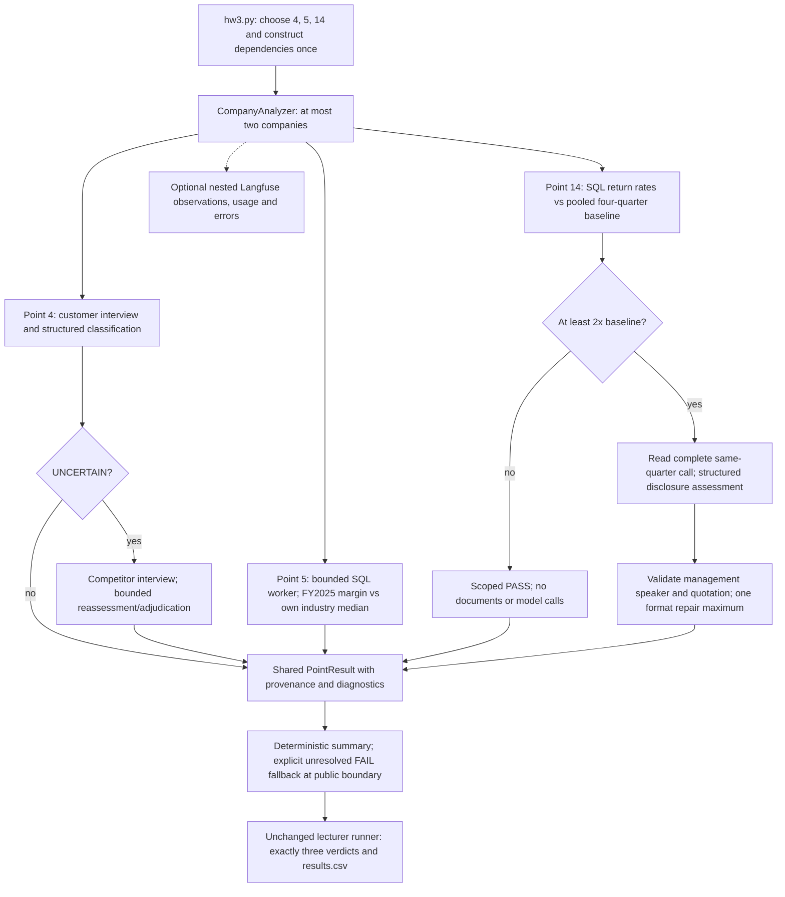

# FTEC5660 Homework 3: Fisher's 15-Point Investment Agent

Build a LangChain agent that researches a company with tools and applies the
framework from Philip Fisher's *Common Stocks and Uncommon Profits* (Part One,
Chapter 3 "What to buy: the fifteen points to look for in a common stock", and
Chapter 4 "What to buy: applying this to your own needs"). You choose 3 of
Fisher's 15 points and decide yourself what PASS means for each. For every
company your agent gives a PASS/FAIL verdict on your 3 points and a short
summary.

The companies are fictional, so the model cannot answer from memory. Unlike a
pile of reports, the evidence is spread over three sources, and your agent has
to go and get it with tools, the way Fisher's "scuttlebutt" method sends an
investor to talk to customers, competitors, suppliers and staff.

## Data and tools

`public_test/` has one folder per company. Your code receives four tools per
company (built by the provided code in `hw3.py`):

| Tool | What it gives you |
| --- | --- |
| `list_documents()` | the company's six documents and their dates |
| `read_document(name)` | one document: the 2025 letter to shareholders, four earnings calls (Q3 2025 to Q2 2026) and a news file (July 2025 to July 2026) |
| `sql_query(query)` | one read-only SQLite query on the company's database; at most 50 rows come back, so use `SUM`, `GROUP BY` and `WHERE` |
| `interview(role, topic)` | what one person says about the company; at most **10 interviews per company** |

The documents are what management says. Management's own claims (such as "we
have never cut research" or "our people are our greatest strength") are not
evidence on their own: check them against the database and the interviews.

**Database tables** (amounts in USD thousands; dates `YYYY-MM-DD`, months
`YYYY-MM`, quarters like `2025Q3`; the fiscal year is the calendar year):

| Table | Columns |
| --- | --- |
| `company` | name, industry |
| `industry_medians` | industry, revenue_growth_2y_pct, new_product_share_pct, new_product_sales_per_rd, operating_margin_pct (one row per industry; use the row for the company's own industry) |
| `orders` | order_id, order_date, product, customer, amount, note (about 3,000 to 4,000 orders from January 2023 to June 2026; revenue is the sum of order amounts) |
| `products` | product, launch_date |
| `monthly_costs` | month, cost_of_sales, selling_admin, research_development |
| `quarterly_cash` | quarter, operating_cash_flow, capex, cash_end |
| `capex_plan` | year, planned_capex (2026 to 2028) |
| `returns` | month, units_shipped, units_returned |
| `insider_trades` | trade_date, person, title, side (`buy` or `sell`), shares, price |

**Terms used in the data.**

| Term | Meaning |
| --- | --- |
| FY2025 | Fiscal year 2025. Here the fiscal year is the calendar year, so FY2025 is January to December 2025. |
| Quarter | Three months of the year: Q1 is January to March, Q2 April to June, Q3 July to September and Q4 October to December. The database writes `2025Q3`; the documents write "third quarter 2025". |
| Amounts | The database is in **USD thousands** (676,100 means US$676.1 million). The documents use USD millions. |
| Revenue | Money from sales: the sum of `amount` in `orders`. |
| Cost of sales | The cost of making the products that were sold. |
| Selling and admin | The cost of selling and of running the company (sales staff, offices, management). |
| R&D | Research and development spending, mainly on new products. |
| Operating margin | Operating profit as a share of revenue: (revenue − cost of sales − selling and admin − R&D) ÷ revenue. |
| Operating cash flow | Cash that the day-to-day business brings in during a quarter. |
| Cash at the end of a quarter | The cash the company holds on the last day of that quarter (`cash_end`). |
| Capex | Capital expenditure: spending on factories, machines and other long-term assets. `capex_plan` holds the planned capex for 2026 to 2028. |
| Return rate | Units returned ÷ units shipped, from the `returns` table. |
| Industry median | The middle value for companies in the same industry, from `industry_medians`. |
| Insider | A director or senior manager of the company. `insider_trades` lists the shares they bought (`buy`) or sold (`sell`). |
| Earnings call | A meeting each quarter where management presents the quarter's results to investors. Each call quotes that quarter's revenue. |

**Interviews.** Roles: `customer`, `current_employee`, `former_employee`,
`competitor`, `supplier`. Topics: `sales_team`, `working_conditions`,
`top_management`, `decision_making`, `competitive_edge`. Only some people know
about each topic; the others say they can't comment, and that answer still
uses up one interview.

| Topic | Who knows about it |
| --- | --- |
| `sales_team` | customer, competitor |
| `working_conditions` | current_employee, former_employee |
| `top_management` | former_employee, supplier |
| `decision_making` | supplier, customer |
| `competitive_edge` | competitor, customer |

People who know about a topic always agree with each other, so one good answer
is enough.

## Choose your 3 points and your rules

Pick any 3 of Fisher's 15 points and write them in `CHOSEN_POINTS` near the
top of `hw3.py`, e.g. `CHOSEN_POINTS = [1, 7, 15]`. The full questions are in
`FISHER_POINTS` in `hw3.py` and in the book.

| # | Fisher's point | Where the evidence is |
| --- | --- | --- |
| 1 | Market potential for sales growth | database |
| 2 | New products as current lines mature | database |
| 3 | Effective research and development | database |
| 4 | Above-average sales organization | interviews (`sales_team`) |
| 5 | Worthwhile profit margin | database |
| 6 | Maintaining or improving margins | database |
| 7 | Labour and personnel relations | interviews (`working_conditions`) |
| 8 | Executive relations | interviews (`top_management`) |
| 9 | Depth of management | interviews (`decision_making`) |
| 10 | Cost analysis and accounting controls | earnings calls, checked against the database |
| 11 | Advantage over competitors | interviews (`competitive_edge`) |
| 12 | Long-range outlook on profits | database |
| 13 | Growth without dilutive equity financing | database |
| 14 | Management talks freely about troubles | earnings calls, checked against the database |
| 15 | Management of unquestionable integrity | news file, checked against the database |

For each of your points, **you design the rule**: which evidence to use, what
to compute or whom to ask, and where the line between PASS and FAIL lies. PASS
means the company looks favourable on that point, as Fisher would see it.

We grade your verdicts against our own answer key. It uses one fixed rule per
point, which we do not publish, and the data never puts a company close to
the line of that rule, so a sensible reading of Fisher usually gives the same
answer. **Test your rules on the public answers**:
`public_test/ground_truth.json` gives the expected verdict on all 15 points
for each of the 20 public companies, and every point fails in 6 of them. If
your rule disagrees with the public answers, rethink it.

**Tip: calculate with tools, not in your head.** Do every sum, ratio and
comparison in SQL or Python, including the number of days between two dates
(SQLite's `julianday()` gives a date as a number of days).

## Student task

Fill in the three places in `hw3.py` marked `### YOUR CODE HERE`. You may add
imports, constants and helper functions above them, but do not change the
provided code below them:

- `CHOSEN_POINTS` lists your 3 points.
- `build_agent()` creates your model and anything else you need once.
- `analyze_companies(agent, companies)` receives
  `{company_folder: [list_documents, read_document, sql_query, interview]}`
  and returns, for every company,
  `{"points": {1: "PASS", 7: "FAIL", 15: "PASS"}, "summary": "..."}` (here with
  `CHOSEN_POINTS = [1, 7, 15]`).

Use the course techniques that fit your points: tool use for the database and
the interviews, planning which interviews to spend, routing each point to the
right source, prompt chaining, parallel calls, reflection to check your
answers, or a combination. Your code must read company data **only through
the four tools**; do not open `company.db` or `interviews.dat` yourself. Do
not hard-code folder names, company names or the public answers.

## Setup and public test

```bash
python3 -m venv .venv
source .venv/bin/activate
pip install -r requirements.txt
echo "DEEPSEEK_API_KEY=your_key_here" > .env
python3 hw3.py --data-folder public_test
```

Use your own DeepSeek API key (from https://platform.deepseek.com). The
required model is `deepseek-v4-flash`. We grade with our own key, so never put
a key in your code; `.env` must stay out of git.

The program creates `results.csv` with the columns `company`, `points`,
`points_correct`, `point_errors`, `interviews_used` and `summary`, and prints
the point score on your 3 points (the percentage after "balanced"). The point
score is the average of two shares: the share of truly passing verdicts that
you marked PASS and the share of truly failing verdicts that you marked FAIL.
For example, 90% and 60% give (90% + 60%) / 2 = 75%, and marking every point
PASS gives (100% + 0%) / 2 = 50%. Once `CHOSEN_POINTS` is set, the starter
runs before you add any API code (it returns no verdicts, so it scores 0%).

`public_test/ground_truth.json` gives the expected verdicts on all 15 points
for each public company. Grading uses a private set of about 20 unseen
companies with the same tools and the same answer key rules, but different
names and wording, and scores your 3 points only.

## Optional Langfuse tracing

Tracing is independent of the analysis implementation. The provided tools,
runner and grading functions are unchanged. The launcher below records the
integrated run; specialists pass the reusable callback config to their model
and supplied-tool invocations.

Normal homework execution needs only `DEEPSEEK_API_KEY`. Without Langfuse keys,
or if its optional SDK cannot initialize, tracing becomes a no-op. SDK callback
and export failures must not change company verdicts or stop the batch.

### Configuration

Use Python 3.11+ for the optional integration. Install the required homework
dependencies normally; add the optional SDK only when tracing is wanted:

```bash
pip install -r requirements-observability.txt
```

This pins Langfuse Python SDK **5.1.0**, using its native LangChain 1.x callback
integration. For self-hosting, SDK v5 requires Langfuse server v4.59.0 or later.
See the [SDK compatibility documentation](https://langfuse.com/docs/observability/sdk/overview).

Copy `.env.example` to `.env` if you do not already have one, then fill values
locally. Do not overwrite an existing `.env`. Set `DEEPSEEK_API_KEY`; optionally
add `LANGFUSE_PUBLIC_KEY`, `LANGFUSE_SECRET_KEY` and `LANGFUSE_BASE_URL` for your
Langfuse project. Use the matching regional URL, such as
`https://cloud.langfuse.com` (EU) or `https://us.cloud.langfuse.com` (US).
Keys are in your Langfuse project's Settings → API Keys. Do not paste or commit
them. `.env` and `.env.*` are ignored, except the blank `.env.example` template.

`LANGFUSE_TRACING_ENABLED=false` explicitly disables tracing even with keys.
`LANGFUSE_TRACING_ENVIRONMENT` labels the environment; `LANGFUSE_TIMEOUT`
sets the SDK request timeout in seconds (default 5). Configuration is read only
after environment loading; imports alone do not initialize the SDK.

### Runtime and component integration

Run the integrated three-point analysis with optional tracing:

```bash
python -m observability.run --data-folder public_test
```

It loads `.env`, owns one tracing lifecycle, calls the unchanged `hw3.main()`,
ends the root observation, then flushes and shuts down once. Exceptions and
exit status are preserved. SDK flush/shutdown errors are best effort; they are
not evidence of successful remote delivery. Wait for all company tasks and
observations to finish before closing. Do not create/close a separate SDK client
for each company: SDK resources are shared by project key.

`build_agent()` injects `current_tracing()` into all three specialists. It returns
the launcher's lifecycle, or `None` under `python hw3.py`. Components pass the
company/point callback config to their LangChain model or supplied tool:

```python
config = tracing.config(
    company_id=company_name, fisher_point=point_number,
    run_name="interpret-company-evidence",
) if tracing is not None else {}
response = await chain.ainvoke(payload, config=config)
```

The config includes company/point identifiers when supplied and the assignment
tag. Native callbacks capture the model name, inputs/outputs, latency, available
provider token usage and errors. Attach once at the outer LangChain invocation;
callbacks propagate to descendants. Reuse the company/point config without
attaching the same handler twice. Omit `fisher_point` for work spanning points.
Trace metadata uses string identifiers; point metadata is not a point selection.

Directly invoked supplied LangChain tools support the same config:
`tool.invoke(arguments, config=config)` or `await tool.ainvoke(arguments, config=config)`.
Their implementation and counters remain untouched. For a direct call that does
not support callbacks, use an explicit observation instead:

```python
with tracing.observation("retrieve-evidence", as_type="tool",
                         company_id=company_name, fisher_point=point_number,
                         input=arguments) as span:
    result = direct_call(arguments)
    span.update(output=result)
```

Use ordinary `with` inside async code too. Context follows async tasks. Do not
combine manual tool spans and native tool callbacks for the same call. Use an
outer company observation and nested point observations when grouping several
independent calls; these can contain native LangChain generations. Manual spans
record exception types and re-raise errors/cancellation. Native callbacks also
record error details, prompts and evidence: keep credentials and configuration
objects out of those payloads. The wrapper never sends environment variables.

### Tests and trace verification

```bash
python -m unittest discover -s test -v
```

Offline tests use mocks at the Langfuse/model boundary and real LangChain
execution to check callback events, usage forwarding, metadata isolation, direct
tools, errors and lifecycle behaviour. They require the normal homework
dependencies, not the optional SDK or credentials. The live test is skipped.

An optional smoke makes **one paid DeepSeek call**, runs a synthetic tool and
an intentional failing tool, then flushes. It performs no company analysis and
does not select points. After setting keys in `.env`, run:

```bash
LANGFUSE_LIVE_SMOKE=true python -m observability.smoke --live
```

Alternatively, run only the live unittest with the same opt-in:
`LANGFUSE_LIVE_SMOKE=true python -m unittest discover -s test -p test_tracing_smoke.py -v`.
Do not run both unless you want two paid calls. The test's opt-in must be in the
shell environment; keys may be in `.env`.

The smoke prints its trace ID. In your project's Tracing view, find that ID
(allow for asynchronous ingestion). Verify:

- Root name `hw3-observability-smoke`, assignment tag and `company_id=observability-smoke`.
- `fisher_point=1` is synthetic smoke metadata, not a homework choice.
- A child generation with `deepseek-v4-flash`, input/output, latency and nonzero token usage.
- The successful synthetic tool, the intentional tool error, and a distinct manually instrumented tool.
- One nested tree with correctly closed observations and no duplicate spans for the same tool call.

A printed ID or passing offline test does not prove ingestion. If nothing appears,
check region, keys, enabled flag and SDK logs; repeat the smoke only after fixing
configuration. Compare the trace with Langfuse's
[best practices](https://langfuse.com/docs/observability/best-practices) and
[LangChain integration](https://langfuse.com/integrations/frameworks/langchain).
This integration follows the [Langfuse AI skill](https://github.com/langfuse/skills/tree/main/skills/langfuse).

## Point 5 strategy experiment (development only)

Two interchangeable `MarginStrategy` implementations expose
`evaluate(company_id, sql_query) -> MarginResult` in `fisher_agent/point5/`:

- `IndustryMarginStrategy`: FY2025 operating margin >= the company's own industry median.
- `HistoricalMarginStrategy`: FY2023–2025 operating margins all > 0, and FY2025 >= FY2023.

Both use only the supplied LangChain SQL tool. Revenue and costs are aggregated
separately before joining, and Python computes
`100 * (revenue - operating_costs) / revenue` with `Decimal`. Costs include cost
of sales, selling/admin and R&D; monetary inputs stay in USD thousands. Rules
use unrounded calculated margins in percentage points. No model calls are made.

Results contain typed annual metrics, original SQL text/results, parsed rows,
company-scoped evidence IDs and a rule summary. Missing/duplicate annual rows,
incomplete monthly costs, null/nonnumeric amounts, nonfinite values, nonpositive
revenue, invalid/missing medians, truncated responses and SQL failures produce
`status='error', verdict=None`, distinct from an evidence-backed FAIL. There are
no retries or interviews. A later grading integration must choose its public
failure mapping explicitly.

Run the comparison and offline checks from the repository root:

```bash
python -m evaluation.compare_point5
python -m unittest discover -s test -v
```

The comparison invokes the unchanged lecturer tool factory, executes both
strategies for all public companies, **then** loads Point 5 ground truth for
scoring. Errors count as incorrect for their true class; their diagnostics are
reported separately. Labels never reach runtime strategies or trace payloads.
`--data-folder` and `--output` can select another development fixture and report.

See [comparison findings](evaluation/point5_comparison.md) and
[full evidence/results](evaluation/point5_results.json). Industry achieves 100%
balanced accuracy; Historical achieves 52.38%. The final integration below
selects Industry for the runtime path and retains both strategies for comparison.

Optional tracing uses the existing lifecycle and closes/flushes on completion:

```bash
python -m evaluation.compare_point5 --trace
```

With the optional SDK and configured credentials, this creates `point5-industry`
and `point5-historical` spans with company ID, Fisher point 5, result, errors and
SQL provenance. Without credentials it still runs. Without `--trace`, the runner
does not initialize Langfuse or load `.env`. No DeepSeek call or API key is needed
for this experiment. Trace payloads are tested offline; live delivery is unverified.

## Homework 3 solution:

### My 3 points and rules

| Point | Why selected and evidence | PASS rule |
| --- | --- | --- |
| 4 — Sales organisation | Fisher's customer/competitor scuttlebutt directly tests sales competence. Use the supplied customer `sales_team` interview, consulting the competitor only after genuine uncertainty. | Concrete interview evidence shows knowledgeable support, consultative problem solving, customer value or favourable sales effectiveness. Product quality or reputation alone does not establish sales competence. |
| 5 — Profit margins | Industry-relative profitability gives a deterministic financial comparison using supplied SQL evidence. IndustryMarginStrategy was selected over the preserved historical alternative. | FY2025 operating margin, including production, selling/admin and R&D costs, is at least the company's own industry median. |
| 14 — Returns disclosure | A fixed returns anomaly provides an objective setback against which to inspect management's same-quarter earnings-call disclosure. Use supplied SQL, document listing and complete relevant calls. | No reporting-quarter return rate reaches twice the pooled preceding-four-quarter rate, or management acknowledges every flagged setback. A validated unacknowledged setback produces FAIL; unresolved evidence stays distinct internally. |

Point 14 deliberately covers returns/quality setbacks, not every form of management
transparency. It validates exact management quotations for acknowledgements; negative
findings require inspection of the complete call. The exact integer rule, zero-baseline
exception and source checks are documented in [Point 14's scoped design](docs/point14-returns-disclosure.md).

### Design

Application construction lives in `fisher_agent/bootstrap.py`; `hw3.build_agent()`
passes the lecturer's `MODEL_NAME` to this composition root. Importing the modules
creates no models, tool calls or tracing clients. Standalone evaluation factories
also live in bootstrap and accept the model name explicitly.

```text
fisher_agent/
├── bootstrap.py          # construct models, specialists and selected strategy
├── company_analyzer.py   # company orchestration and public-output assembly
├── contracts.py          # shared PointResult, provenance and diagnostics
├── point4/               # sales interpretation, validation, records and adapter
├── point5/               # SQL evidence, Decimal strategies, runner and adapter
└── point14/              # scoped returns evidence, disclosure and records
```

Specialist logic was relocated with import updates; prompts, rules, model settings,
execution budgets, trace metadata and public payloads are unchanged. The historical
validation reports below refer to their recorded pre-refactor commits and paths.



The three specialists run independently within each company using the same supplied
tool instances. Python owns routing, arithmetic, validation, aggregation and the
summary; LangChain with `deepseek-v4-flash`, thinking disabled, handles only semantic
interpretation. Point 4 and Point 5 adapt their owned records to the shared
`PointResult`; Point 14 already returns it. `CompanyAssessment` retains the original
sales, margin and `ReturnsRun` records, including provenance, findings, diagnostics,
model/tool counts and token usage. Company observations expose statuses and counts
without repeating every child tool payload. Labels are used only after predictions
by development evaluation and the lecturer scorer.

Each company has a 125-second deadline and at most two companies run concurrently,
within a 1,200-second batch budget. Point 4 retains its 90-second company deadline,
Point 14 its 120-second deadline, and both use 20-second model attempts with zero SDK
retries. Point 14 permits at most eight attempts across four events, including one
format/provenance repair per event. Point 5's SQL deadline is 10 seconds including
queue time, with at most two physical daemon workers. Completed independent verdicts
survive a neighbouring failure or timeout; queued companies receive error entries
when the batch budget expires. Cancellation propagates.

Internal errors and insufficient evidence carry `verdict=None`. The homework has no
public UNKNOWN, so the final adapter emits all of Points 4, 5 and 14, using an explicit
FAIL-fallback summary for an unresolved point. This fallback is never counted as a
grounded verdict in development review. No additional summarisation model is used.

### Run and test

Install `requirements.txt`, set `DEEPSEEK_API_KEY` in the ignored `.env`, then run:

```bash
python hw3.py --data-folder public_test
python -m unittest discover -s test -v
```

For optional company/point traces, install `requirements-observability.txt` and run:

```bash
python -m observability.run --data-folder public_test
```

Tracing credentials remain optional. The launcher owns one lifecycle; the supplied
tool callbacks, generations, specialist decisions and final company output nest under
`assess-company`. A trace ID alone does not establish remote ingestion.

The deterministic strategy comparison remains reproducible with
`python -m evaluation.compare_point5 --output .review/point5-comparison-new.json`.
`evaluation/combined.py` and [its report](evaluation/combined-results.md) are historical
two-point milestone records: their scores and sales-only usage are not the final
three-point evaluation. Generated JSON, CSV and trace artifacts stay local and ignored.

### Results and limits

Two actual lecturer-entry runs on 1 November 2026 each produced **60/60 grounded
correct verdicts**: **100% accuracy, balanced accuracy, PASS recall (42/42) and FAIL
recall (18/18)**. Each point scored 20/20, with PASS recall 14/14 and FAIL recall 6/6;
there were no public disagreements, missing verdicts or operational fallback credits.
The fresh GitHub checkout, installed only with `pip install -r requirements.txt` and
run without Langfuse credentials or SDK, exited normally in **18.22 seconds**.
The optional traced entry run took **15.98 seconds** and recorded 32 model calls,
25,515 input / 4,895 output tokens, 60 SQL queries, 20 customer interviews and 24
document-tool calls. Eight Point 14 no-anomaly paths used neither documents nor LLMs.

[Final integration validation](evaluation/final-integration-results.md) records the
examined commit, commands, independent scoring, clean-checkout checks and remotely
retrieved trace. The offline suite has **115 passing tests and one optional paid
smoke skipped**, reproduced with Python 3.13.9 and a clean Python 3.14.0 environment.
The earlier [Point 4](evaluation/point4-results.md),
[Point 5 comparison](evaluation/point5_comparison.md) and
[Point 14 experiment](evaluation/returns-disclosure-results.md) remain historical
baselines. Point 5's historical alternative scored 52.38% balanced accuracy and is
not selected for runtime.

Public evidence has informed development and is not held-out validation. The calls
are templated; private-company accuracy and run-to-run variation remain unproven.
Point 14 ignores non-returns troubles, and its rolling baseline may be affected by
persistent anomalies or seasonality. Exact quotations establish source grounding,
not correct interpretation. Python cannot kill a blocked synchronous SQL thread;
a timed-out worker retains its slot until return and may outlive its trace. If an
outer deadline cancels a model-bearing specialist before it returns, company-level
usage is partial (`usage_complete=false`); child generations remain the audit source
for provider-reported usage. No fallback credit establishes semantic correctness.

## Point 4 development slice

The independently testable sales specialist is implemented in `fisher_agent/point4/`.
It uses the customer `sales_team` interview first, consults the competitor only
after a valid UNCERTAIN assessment, then makes one final adjudication if needed.
Quotes and source IDs are checked in Python. The model judges their meaning.

The standalone slice remains independently evaluable; the final integration
also wires it into the homework entry point alongside Points 5 and 14.
See [Point 4 design and limits](docs/point4.md).

Run offline checks without credentials or services:

```bash
python -m unittest discover -s test -v
```

Run the development evaluation from the repository root (paid DeepSeek calls):

```bash
python -m evaluation.point4 --live --data-folder public_test --output evaluation/point4-latest.json
```

The runner uses the unchanged lecturer tool factory, predicts before loading
labels, and writes every company's original interviews, validated assessments,
diagnostics, interview/model counts, usage and trace ID. It prints PASS recall,
FAIL recall, balanced accuracy and misclassifications. Operational fallback
matches are counted separately from grounded correct assessments. Exit code 2
means at least one company did not receive a supported final assessment.

Optional tracing uses the same `.env` configuration above and closes one shared
lifecycle after all companies finish. Filter Langfuse by `fisher_point=4` and
`company_id`; inspect `assess-sales`, `classify-sales-initial`, `reassess-sales`
and `adjudicate-sales`. Native callbacks capture interview calls and generations
with available token usage. Diagnostic observations distinguish uncertainty,
invalid output and API/retrieval failures. JSON trace IDs do not prove ingestion.

Current measured status and rerun instructions: [Point 4 evaluation](evaluation/point4-results.md).


## Task 2: Reflection — AI sycophancy and AI psychosis

*AI-assisted reflection, permitted by the assignment; grounded in this project's
recorded engineering experiments.*

An agreeable model can validate the desired answer instead of testing it. In this
project, accepting a sophisticated-looking transparency architecture or a public
score at face value would have hidden unsupported contradictions, abstentions and
operational FAIL fallbacks. The useful response was to inspect original evidence,
separate execution from correctness, and allow an experiment to fail. More model
reasoning did not automatically produce better reasoning.

The assignment's phrase “AI psychosis” also raises the danger of a feedback loop:
a user proposes an unsupported narrative, the model reinforces it confidently, and
that agreement is then treated as new evidence. This is a reflection on how to use
the technology, not a diagnosis of a person. Confidence and fluent language are not
independent corroboration. Evidence should remain inspectable, uncertainty should
remain visible, and consequential conclusions should be open to human challenge.

The resulting engineering rule is to give models narrow semantic questions while
keeping arithmetic, provenance checks and final aggregation in Python. Even a
perfect public score is limited evidence: it neither proves general transparency
nor guarantees performance on unseen companies. A useful assistant must be able to
disagree, abstain and explain what would change its conclusion.

## Submission

The assignment PDF requires a **public GitHub repository named `FTEC5660-HW3`**.
Enter `https://github.com/alistairkung/FTEC5660-HW3` in the course submission form
before **16 November, 23:59 HKT**; the last commit before the deadline is graded.
Submit the repository link, including `hw3.py`, `requirements.txt`, this README
report/reflection and the supporting tracked modules. No separate archive is
specified. Keep the repository public and API keys out of Git. The private grader
uses its own key, runs three times and averages the balanced score; every run must
produce `results.csv` within 30 minutes.
