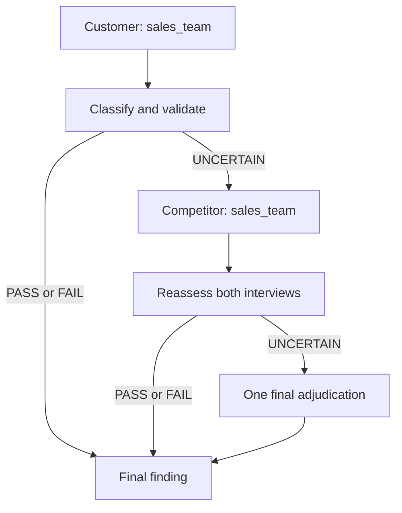

# Fisher Point 4: sales organisation

PASS requires interview evidence connecting the sales organisation to knowledgeable
support, consultative problem solving, customer value or relationships, or favourable
competitive effectiveness. FAIL requires evidence of weakness in those capabilities.
Product quality, growth and reputation alone do not qualify. Irrelevant or ambiguous
interviews produce internal UNCERTAIN, never a successful final UNCERTAIN result.

`SalesSpecialist` sequences supplied tools and owns per-company state and budgets.
`EvidenceInterpreter` uses LangChain structured function output (`SalesAssessment`)
for semantic judgement. `result_validator` enforces schema, one-company source
membership and exact contiguous quotes. Original answers, role/topic arguments and
stable interview IDs remain in `InterviewEvidence`. `bootstrap` constructs only the
lecturer's `MODEL_NAME`, with temperature 0, 600 output tokens and SDK retries off.
Thinking is explicitly disabled with `extra_body={'thinking': {'type': 'disabled'}}`
so DeepSeek accepts the named structured-output tool choice. The optional tracing
smoke uses the same explicit setting.
No other evidence source, autonomous tool selection or application label access exists.

## Bounds and failure policy

| Path | Interviews | Normal model calls |
| --- | ---: | ---: |
| Clear initial verdict | 1 | 1 |
| Competitor resolves uncertainty | 2 | 2 |
| Final adjudication | 2 | 3 |

One output-repair retry is allowed per classification stage (at most six total
model attempts); it reuses the same interviews. Invalid schema, multiple structured
answers and fabricated quotes/references trigger this retry. Transport retries are
zero at both SDK and application levels; interview calls are never retried.
Tool timeout: 5 seconds. Model attempt timeout: 20 seconds. Company deadline:
90 seconds. Batch concurrency: 2, giving a nominal 15-minute deadline bound for
20 companies. Cancellation propagates. Normal model invocations need no Langfuse keys.

Every exhausted failure maps to public FAIL with an explicit failure summary and
internal `invalid_output`, `api_error`, `retrieval_error`, `deadline` or
`internal_error` status. Remaining UNCERTAIN after adjudication maps to FAIL with
`insufficient_evidence`. These are operational fallbacks, never evidence-backed
investment FAILs. API/retrieval failures stop that company's workflow; they do not
justify a competitor interview or affect another company's result.

Final adjudication asks for the stronger supported PASS/FAIL interpretation.
If neither has any support, it is allowed to report internal UNCERTAIN rather than
invent facts; the explicit insufficient-evidence failure policy then applies.

## Review limits

Exact quote validation proves provenance, not semantic entailment. The interpretation
can still be wrong; inspect the quoted passage and concise model explanation. The
repaired public baseline produced 20/20 grounded classifications, 100% balanced
accuracy and no operational fallbacks in 13.78 seconds; remote trace ingestion and
closed observations were independently verified. See [evaluation results](../evaluation/point4-results.md).
This is one full baseline; private accuracy and run-to-run variance remain unmeasured.
Temperature zero does not guarantee repeatable model outputs. A final forced decision
from ambiguous evidence is marked `adjudicated` so it can be reviewed separately.
Supporting modules follow the workspace package convention; final submission should
be tested from a fresh clone when all three points are integrated.
